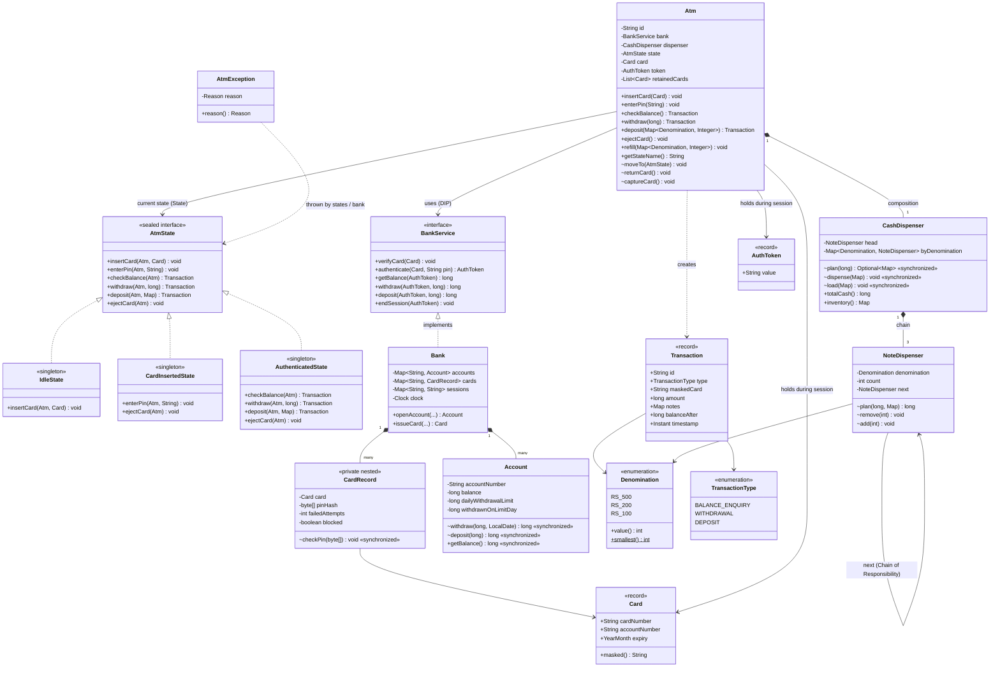
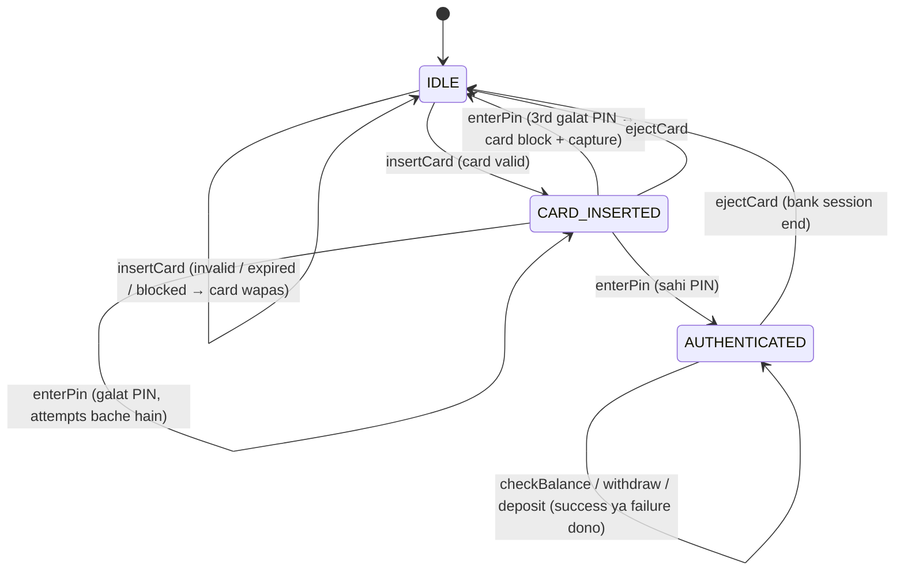
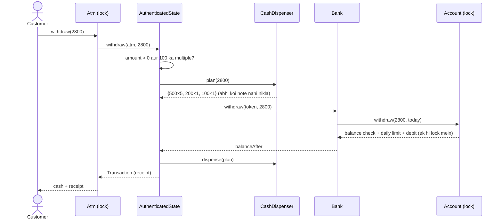

# ATM — Class Diagram

## ATM ki state machine

Jo arrow diagram mein nahi hai, woh action us state mein `IllegalStateException` deta hai
(jaise IDLE mein `withdraw`). Yeh rule `AtmState` ke default methods se aata hai.

## Withdrawal ka sequence (sabse important flow)

Agar `plan` fail ho → `CASH_UNAVAILABLE`, account ko chhua tak nahi.
Agar bank mana kare → `INSUFFICIENT_FUNDS` / `DAILY_LIMIT_EXCEEDED`, ek bhi note nahi nikla.
Agar `dispense` fail ho (real life mein jam) → bank ko wahi amount wapas `deposit` (compensating transaction).

## Relationships ka matlab (Hinglish)

| Relationship | Symbol | Matlab |
|---|---|---|
| `Atm --> AtmState` | Association | ATM ke paas **current state** hai; har public method state ko delegate karta hai — **State pattern** |
| `AtmState <\|.. IdleState/...` | Realization | Teen states, ek sealed interface. Nayi state = nayi class + `permits` mein naam |
| `Atm *-- CashDispenser` | Composition | Cash cassettes machine ka **part** hain; ATM ke bina unka koi matlab nahi |
| `NoteDispenser --> NoteDispenser` | Self-association | Har note ka cassette agle (chhote) note ko baaki amount pass karta hai — **Chain of Responsibility** |
| `Atm --> BankService` | Dependency | ATM interface pe depend karta hai, `Bank` class pe nahi — **Dependency Inversion** |
| `Bank *-- Account / CardRecord` | Composition | Accounts aur PIN data bank ke andar rehte hain; ATM ko kabhi PIN ya balance object nahi milta |
| `Transaction`, `Card`, `AuthToken` | Records | Immutable value objects — share karna safe hai |

## Key design points

1. **Layering — har class ka ek kaam:**
   `Atm` = customer ka facade + state machine ka context,
   `AtmState` = "is state mein kya allowed hai",
   `CashDispenser` = notes ka hisaab,
   `BankService` = paisa aur PIN (source of truth bank hai, ATM nahi).

2. **State pattern kyun?** Bina pattern ke har method mein `if (state == IDLE) ... else if ...` likhna padta.
   Ab har state sirf apne allowed actions override karti hai; baaki sab default method se reject.
   States mein koi data nahi (sab `Atm` mein hai), isliye har state ek **singleton** hai.
   `sealed` hone se poori state list ek line mein dikhti hai.

3. **Chain of Responsibility (cash dispense):** `500 → 200 → 100`. Har link jitne note de sakta hai deta hai,
   baaki agle ko. Naya note (₹2000 ya ₹50) add karna = `Denomination` mein ek line, chain apne aap ban jaati hai.

4. **Plan → Debit → Dispense (sabse bada correctness rule):**
   pehle sirf *plan* (kuch move nahi hota), phir bank debit, phir notes nikalna.
   Isse dono galat cases impossible ho jaate hain: "paisa kata par cash nahi mila" aur "cash mila par paisa nahi kata".
   Deposit mein ulta order: pehle bank credit, phir notes rakho.

5. **AuthToken, account number nahi:** PIN sahi hone pe bank ek token deta hai; har money operation us token se hota hai.
   ATM kisi aur ka account number bhej kar paisa nahi nikaal sakta. `ejectCard` pe token invalidate.

6. **Security basics:** Bank PIN ka sirf salted SHA-256 hash rakhta hai, compare `MessageDigest.isEqual` se
   (constant time). Card number hamesha masked print hota hai. Forged card (asli number, galat account) reject.

7. **Business failure vs programming error:**
   `AtmException(reason)` = customer ko screen pe dikhane wali cheez (insufficient funds, wrong PIN);
   session khula rehta hai, customer dobara try kar sakta hai.
   `IllegalStateException` = galat order mein call (bina card ke withdraw) — yeh bug hai, screen message nahi.

## Concurrency — kaun sa lock kya bachata hai

Ek ATM pe ek hi customer hota hai, par **bahut saare ATM ek hi bank** se baat karte hain.

| Shared state | Kaun guard karta hai | Kya bachata hai |
|---|---|---|
| `Account.balance`, daily limit | `Account` ke `synchronized` methods | Joint account ke do holder do ATM se ek saath nikaalein to bhi overdraw nahi. Check + debit ek lock mein. Account hi locking unit hai, alag accounts kabhi contend nahi karte |
| `CardRecord.failedAttempts` / `blocked` | `CardRecord` ka lock | Do ATM pe ek saath PIN guess karke 3 se zyada try nahi milte |
| `Bank.accounts / cards / sessions` | `ConcurrentHashMap` | Atomic `putIfAbsent` (duplicate account/card nahi), atomic `remove` (logout ke baad token dead) |
| `Atm.state`, `card`, `token`, cash | `Atm` ke `synchronized` methods | Withdraw ka plan-debit-dispense beech mein operator refill ya doosre call se interleave nahi hota |

**Lock order hamesha `Atm → CashDispenser / Account / CardRecord`** hai, aur bank kabhi ATM ko call back nahi karta,
isliye deadlock possible nahi. Mutators (`Account.withdraw`, `CashDispenser.dispense`, `Atm.moveTo` ...) package-private hain,
taaki bahar ka code in rules ko bypass na kar sake.

`Main` section 5 aur `AtmTest.concurrentWithdrawalsOnOneAccountNeverOverdraw` (20 ATMs, ₹10,000, har ek ₹1,000 maange →
exactly 10 success) yeh prove karte hain.

## Jaan-boojh kar liye gaye trade-offs

- **Greedy note selection:** largest-first hamesha best nahi hota jab cassettes mein note kam hon.
  Example: sirf `500×1, 200×3` bache hain aur ₹600 maange — greedy 500 leta hai, 100 nahi hai, fail; jabki `200×3` chal jaata.
  100 ka note available ho to greedy hamesha sahi hai. Fix chahiye to `NoteDispenser.plan` mein backtracking (ek kam note try karo).
- **In-memory bank:** asli system mein `BankService` ek network client hoga, aur debit ke liye idempotency key / two-phase
  confirm chahiye hoga (network timeout pe double debit na ho).
- **Session timeout nahi hai:** real ATM 30–60 sec inactivity pe card return karta hai — ek `ScheduledExecutorService` se
  `ejectCard` call karna hoga.

## Extend kaise karein (Open/Closed)

| Requirement | Change |
|---|---|
| ₹2000 / ₹50 note | `Denomination` mein ek constant |
| PIN change, mini statement, fund transfer | `AtmState` mein naya default method + `AuthenticatedState` mein override + `BankService` mein method |
| Out-of-service state (cash khatam / maintenance) | Nayi `OutOfServiceState`, `permits` mein add; `Atm.refill` use wapas `IDLE` le jaaye |
| Asli bank | Naya `BankService` implementation; ATM code untouched |
| Receipt print / SMS | `Transaction` already immutable hai — ek `TransactionListener` (Observer) add karo jo `Atm.record` ke baad call ho |
