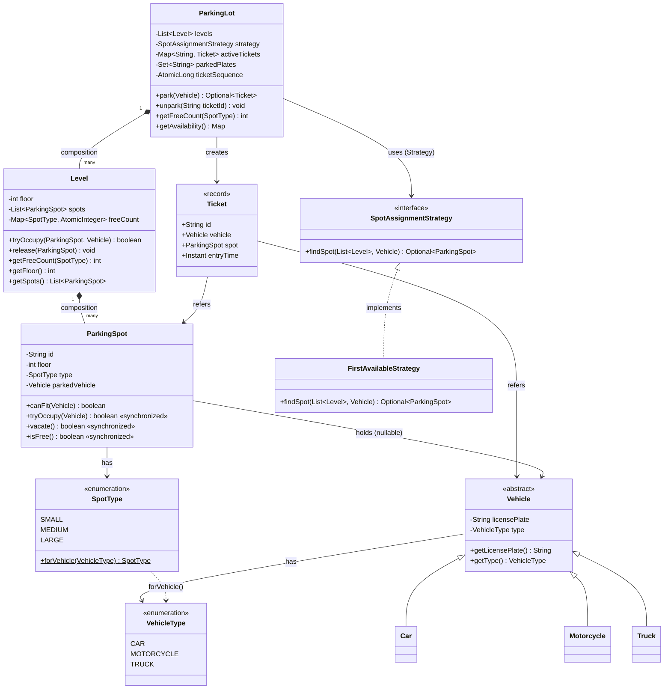

# Parking Lot — Class Diagram

## Relationships ka matlab (Hinglish)

| Relationship | Symbol | Matlab |
|---|---|---|
| `ParkingLot *-- Level` | Composition (solid diamond) | Levels ParkingLot ke **part** hain; lot ke bina level ka koi matlab nahi |
| `Level *-- ParkingSpot` | Composition | Spots level ke andar hi bante aur rehte hain |
| `ParkingLot --> SpotAssignmentStrategy` | Dependency/Association | Lot strategy ko **use** karta hai, own nahi karta — kal badal sakte ho |
| `FirstAvailableStrategy ..|> SpotAssignmentStrategy` | Realization (dashed) | Interface ka implementation — **Strategy pattern** |
| `Vehicle <|-- Car/Motorcycle/Truck` | Inheritance | "is-a" relationship |
| `Ticket --> Spot/Vehicle` | Association | Ticket sirf **reference** rakhta hai, ownership nahi |

## Key design points diagram se

1. **Layering:** `ParkingLot → Level → ParkingSpot` — har layer apna kaam karti hai.
   Lot = orchestration, Level = counting, Spot = locking.
2. **Strategy pattern:** `ParkingLot` interface pe depend karta hai, concrete class pe nahi
   (Dependency Inversion). Nayi strategy = nayi class, purana code untouched (Open/Closed).
3. **Enums ka bridge:** `SpotType.forVehicle()` hi ek jagah hai jahan
   VehicleType aur SpotType judte hain.
4. **Mutable state sirf 2 jagah hai:** `ParkingSpot.parkedVehicle` (synchronized) aur
   `Level.freeCount` (AtomicInteger). Baaki sab immutable — isliye thread-safe.

